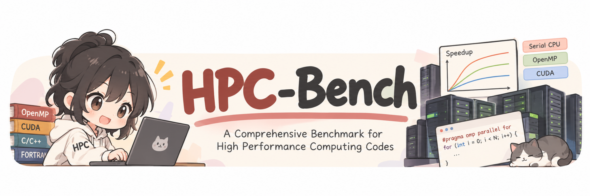
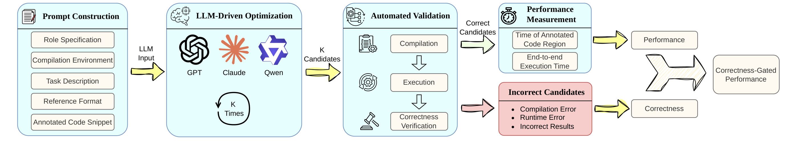
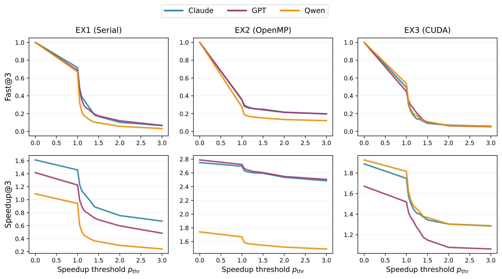
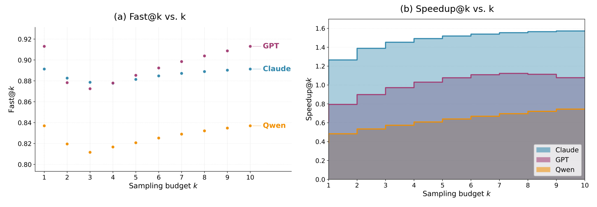
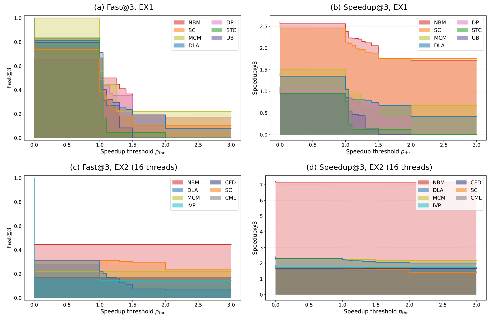

<h1 align="center">
  
</h1>

<p align="center">
  <b>HPC-Bench: A Comprehensive Benchmark for High Performance Computing Codes</b><br>
  NeurIPS 2026 Evaluations and Datasets Track
</p>

<p align="center">
  <a href="https://huggingface.co/datasets/bcui2/HPC-Bench"> Input Data</a> |
  <a href="docs/REPRODUCING_PAPER.md"> Reproducing the Paper</a> |
  <a href="docs/BENCHMARKS.md"> Benchmark Catalog</a>
</p>

## 👋 Overview

HPC-Bench is a performance-grounded benchmark for evaluating large language models as optimizers of computational kernels in realistic HPC workloads.
Each task asks a model to optimize a profiler-identified kernel region that is embedded in a complete benchmark program. Every generated candidate is spliced back into the unmodified program, compiled, executed, checked for correctness at the program level, and timed.

The benchmark covers **114 workloads across 16 HPC computational motifs**: 92 CPU workloads evaluated under serial and OpenMP optimization, and 22 CUDA workloads evaluated under GPU optimization. Two correctness-gated, sampling-aware metrics, **Fast@k** and **Speedup@k**, report how reliably a model finds a correct optimization and how large the achieved speedup is under a fixed sampling budget.



## 📑 Contents

- [Features](#-features)
- [Results](#-results)
- [Benchmark Suite](#-benchmark-suite)
- [Optimization Settings](#-optimization-settings)
- [Metrics](#-metrics)
- [Installation](#-installation)
- [Input Data](#-input-data)
- [Quick Start](#-quick-start)
- [LLM Code Generation](#-llm-code-generation)
- [Reproducing the Paper](#-reproducing-the-paper)
- [Project Structure](#-project-structure)
- [Citation](#-citation)
- [License and Attribution](#-license-and-attribution)

## ✨ Features

- **114 workloads, 16 motifs** drawn from PolyBench, Rodinia, Parboil, MachSuite, MiBench, PARSEC, and Codee.
- **Three optimization settings**: serial CPU (EX1), OpenMP CPU (EX2), and CUDA GPU (EX3).
- **Program-level evaluation**: each candidate replaces only the annotated kernel region and is evaluated inside the original program and harness.
- **Five standardized input scales** per workload (mini, small, medium, large, extra-large), each with its own input content.
- **Suite-specific correctness checkers** covering numeric comparison with per-benchmark tolerances, exact text comparison, and binary comparison.
- **Kernel and end-to-end timing** with calibrated warmup and repeated measurements.
- **Correctness-gated metrics**: Fast@k and Speedup@k, stratified by motif, difficulty level, input scale, and thread count.
- **Structural difficulty levels** d1–d4 computed from the annotated region's lines of code, branches, loop depth, and function count.
- **Complete released results**: 30 generated candidates per workload and setting (3 models × 10 samples), with per-trial correctness and timing.

## 📊 Results

We evaluate GPT-5.1, Claude Sonnet 4.5, and Qwen3-Coder-480B-A35B-Instruct, with N = 10 candidates per model and workload.



*Fast@3 (top) and Speedup@3 (bottom) versus the speedup threshold p<sub>thr</sub> for EX1–EX3, macro-averaged over benchmarks and the five input scales. EX2 uses 16 threads.*

Values are averaged over the five input scales and reported at p<sub>thr</sub> = 1.0 / 1.5.

| Setting | Metric | Claude Sonnet 4.5 | GPT-5.1 | Qwen3-Coder |
|:---|:---|:---:|:---:|:---:|
| EX1 (serial) | Fast@3 | 0.72 / 0.17 | 0.69 / 0.17 | 0.67 / 0.10 |
| | Speedup@3 | 1.46× / 0.87× | 1.23× / 0.69× | 0.94× / 0.36× |
| EX2 (OpenMP, 16 threads) | Fast@3 | 0.35 / 0.25 | 0.36 / 0.24 | 0.27 / 0.15 |
| | Speedup@3 | 2.70× / 2.60× | 2.72× / 2.60× | 1.67× / 1.55× |
| EX3 (CUDA) | Fast@3 | 0.49 / 0.09 | 0.45 / 0.11 | 0.54 / 0.11 |
| | Speedup@3 | 1.75× / 1.34× | 1.52× / 1.15× | 1.82× / 1.37× |

- **Reliability drops sharply with the required speedup.** Models often find correct or modestly faster candidates, but Fast@3 falls quickly as p<sub>thr</sub> rises, most steeply for CUDA.
- **Large gains are concentrated in a subset of workloads.** EX2 Speedup@3 stays high because a few highly parallelizable kernels (for example `matmul`, `haccmk`, `coulomb`, `hotspot3D`) reach 13–50×, while many short-running kernels are slowed down by OpenMP overhead.
- **Correctness decreases with setting complexity**: 76.9% of candidates are correct in EX1, 61.4% in EX2, and 38.8% in EX3.

### Sampling budget



*EX1, medium input, p<sub>thr</sub> = 1.05. More samples mainly help models find stronger candidates (Speedup@k grows) rather than change whether any qualifying candidate exists (Fast@k stays in a narrow band).*

### Motif-level results



*Motif-stratified Fast@3 and Speedup@3 on the medium input, macro-averaged over the three models. Each row shows the seven motifs with the highest Speedup@3 at p<sub>thr</sub> = 1.0 in that setting.*

Compute-regular and data-parallel motifs such as N-body methods, stencils, Monte Carlo, and dense linear algebra benefit most. Irregular access, sparse layouts, traversal dependencies, and short-running kernels limit the gains.

## 🧩 Benchmark Suite

### CPU workloads (EX1 and EX2)

| Suite | # Workloads | Examples |
|:---|---:|:---|
| PolyBench | 30 | `2mm`, `gemm`, `cholesky`, `jacobi-2d`, `heat-3d`, `nussinov` |
| Rodinia | 19 | `bfs`, `cfd`, `hotspot`, `hotspot3D`, `lavaMD`, `particlefilter` |
| MachSuite | 18 | `aes`, `fft-strided-mach`, `md-knn-mach`, `spmv-crs-mach`, `viterbi-mach` |
| Parboil | 10 | `cutcp`, `histo`, `lbm`, `mri-q`, `sgemm`, `spmv`, `tpacf` |
| MiBench | 9 | `dijkstra-mibench`, `qsort-mibench`, `susan-e-mibench` |
| Codee | 5 | `atmux`, `coulomb`, `haccmk`, `matmul`, `pi` |
| PARSEC | 1 | `canneal-parsec` |
| **Total** | **92** | |

### Computational motifs

| Motif | # | Motif | # |
|:---|---:|:---|---:|
| Dense Linear Algebra (DLA) | 22 | Clustering / Machine Learning (CML) | 4 |
| Stencil / Scientific Computing (SC) | 13 | Medical / Scientific Computing (MSC) | 4 |
| Image and Video Processing (IVP) | 7 | Statistical Computations (STC) | 4 |
| Graph Algorithms (GA) | 6 | Utility Benchmarks (UB) | 4 |
| N-body Methods (NBM) | 6 | Monte Carlo Methods (MCM) | 3 |
| Dynamic Programming (DP) | 5 | Sparse Linear Algebra (SLA) | 3 |
| Sorting / Search (SS) | 5 | Cryptography / Encoding (CE) | 2 |
| Computational Fluid Dynamics (CFD) | 2 | Spectral Methods (SM) | 2 |

Difficulty levels: 61 workloads at d1, 17 at d2, 9 at d3, and 5 at d4.

### CUDA workloads (EX3)

EX3 uses Rodinia-derived CUDA benchmarks. They partially overlap with the Rodinia CPU workloads and add GPU-oriented workloads such as `dwt2d`, `gaussian`, `huffman`, and `hybridsort`.

The per-benchmark catalog with suite, motif, difficulty level, and upstream references is in [`docs/BENCHMARKS.md`](docs/BENCHMARKS.md).

## ⚙️ Optimization Settings

| Setting | Target | What the model may change | Build |
|:---|:---|:---|:---|
| **EX1** | Serial CPU | Single-threaded source transformations: loop restructuring, redundant-computation elimination, locality and memory-access optimization. No parallel constructs. | `gcc -O3` |
| **EX2** | OpenMP CPU | Serial optimizations plus OpenMP parallelization. The thread count is set by `OMP_NUM_THREADS` (measured at 1, 2, 8, 16, 32); prompts forbid hard-coding it. | `gcc -O3 -fopenmp` |
| **EX3** | CUDA GPU | Kernel-level CUDA optimization: memory coalescing, shared memory, occupancy, and algorithmic changes. | `nvcc` (CUDA 12.4) |

Each prompt contains the role and compilation environment, the setting-specific task description, the required output format, the annotated kernel region, and the minimal compilation context of the benchmark. Prompt templates are built by `scripts/arg.py` and `scripts/head_code.py`.

Paper measurements were taken on an AMD EPYC 7543 (32 cores) and an NVIDIA A100, with GCC 14.2 and CUDA 12.4.

## 📐 Metrics

For each benchmark, a model produces N candidates. A candidate counts at threshold p<sub>thr</sub> when it is correct and its kernel speedup over the baseline is at least p<sub>thr</sub>. Let c<sub>p</sub> be the number of such candidates.

- **Fast@k**: the probability that at least one of k candidates, drawn uniformly without replacement from the N, is correct and reaches p<sub>thr</sub>:

  Fast@k = 1 − C(N − c<sub>p</sub>, k) / C(N, k)

- **Speedup@k**: the expected best correctness-gated speedup over a uniformly drawn k-subset of the N candidates. A subset with no qualifying candidate contributes 0, so Speedup@k can fall below 1.

Both metrics are computed per benchmark and then macro-averaged, so every benchmark carries equal weight. The paper reports k = 3 with N = 10 unless stated otherwise.

## 📦 Installation

| Component | Tested version |
|:---|:---|
| Linux | RHEL 8 (x86-64) |
| GCC / G++ | 14.2 |
| Clang / Clang++ | 19.1 (optional) |
| CUDA Toolkit | 12.4 (EX3 only) |
| Python | 3.10+ |

```bash
git clone https://github.com/Deep-Learning-Profiling-Tools/HPC-Bench.git
cd HPC-Bench

python -m venv .venv
source .venv/bin/activate
pip install -r requirements.txt
```

## 💾 Input Data

The input datasets for all five scales are hosted on Hugging Face at [bcui2/HPC-Bench](https://huggingface.co/datasets/bcui2/HPC-Bench), one archive per setting and benchmark. One command downloads them, verifies each archive's SHA-256 checksum, and extracts it into `EX*/<benchmark>/input_data/`:

```bash
python tools/fetch_input_data.py                          # everything (~38 GB zipped)
python tools/fetch_input_data.py --ex EX1                 # one setting
python tools/fetch_input_data.py --ex EX1,EX2 --benchmarks 2mm,bfs
python tools/fetch_input_data.py --list                   # show available archives and sizes
```

Benchmarks whose `input_data/` already exists are skipped unless `--force` is given. Downloaded archives are removed after extraction unless `--keep-archives` is given.

## 🚀 Quick Start

```bash
source tools/setup_env.sh
python tools/fetch_input_data.py --ex EX1 --benchmarks 2mm

# List benchmarks
python scripts/arg.py benchmark list --benchmarks all

# Build the baseline and the 30 released LLM candidates
python scripts/arg.py benchmark build --root . --benchmarks 2mm --ex-versions EX1

# Capture outputs of the baseline and the candidates, then check correctness
python scripts/arg.py benchmark correctness-run --root . --benchmarks 2mm \
  --ex-versions EX1 --models baseline,claude --datasets mini,small
tools/run_correctness.sh EX1 2mm

# Rebuild (correctness-run consumes the executables) and measure runtime
python scripts/arg.py benchmark build --root . --benchmarks 2mm --ex-versions EX1
tools/run_time_measurement.sh EX1 2mm --models baseline,claude --datasets mini,small
```

Correctness results are written to `results/correctness/<benchmark>/<EX>/correctness.jsonl` and timings to `results/time_measurements/<benchmark>/<EX>_time_measurements.jsonl`.

## 🤖 LLM Code Generation

`benchmark auto-run` constructs the prompt for each benchmark, queries a model, extracts the code between `<<<CODE>>>` and `<<<END-CODE>>>`, and writes candidates to `EX<N>/<benchmark>/EX<N>_optimized_codes/<stem>_<model>_v<i>.<ext>`.

```bash
export ANTHROPIC_API_KEY="..."   # or OPENAI_API_KEY / TOGETHER_API_KEY

python scripts/arg.py benchmark auto-run \
  --root . --ex-version EX1 --benchmarks 2mm \
  --llm-model claude-sonnet-4-5-20250929 --llm-abbrev claude --model-family claude \
  --max-attempts 10 --write-state
```

Supported `--model-family` values are `openai`, `claude` / `anthropic`, `together`, and `hpc-coder`. To add a provider, subclass `LLMClient` in `scripts/llm/base.py` and register it in `scripts/llm/factory.py`.

The candidates used in the paper are included in the repository, so the evaluation can be reproduced without API access.

## 🔁 Reproducing the Paper

`final_data/` contains the per-trial results behind every figure: `unified_results.csv` for EX1 and EX2 and `unified_results_ex3.csv` for EX3. The paper figures are regenerated from these files without re-running any measurement:

```bash
python scripts/analysis/plot_combined_main_figure.py          # Fast@3 / Speedup@3 vs. p_thr (EX1–EX3)
python scripts/analysis/plot_k_sensitivity_new_style.py       # Fast@k / Speedup@k vs. k (EX1)
python scripts/analysis/plot_appendix_stratified_stepfill.py  # motif- and difficulty-stratified results
python scripts/analysis/plot_appendix_k_sensitivity_ex2_ex3.py
python scripts/analysis/plot_appendix_thread_sensitivity.py
python scripts/analysis/plot_best_of_n_distribution.py
python scripts/analysis/plot_total_time_figures.py
```

Outputs are written to `analysis_summaries/`. Each script reproduces the corresponding paper figure exactly. See [`docs/REPRODUCING_PAPER.md`](docs/REPRODUCING_PAPER.md) for the figure-to-script mapping and for re-running the full measurement pipeline.

## 📁 Project Structure

```text
HPC-Bench/
├── EX1/                     # Serial CPU setting: 92 benchmarks
│   └── <benchmark>/
│       ├── Makefile, sources, headers
│       ├── input_data/      # Fetched from Hugging Face (Git-ignored)
│       └── EX1_optimized_codes/
│           ├── <stem>.<ext>                 # Baseline kernel
│           └── <stem>_<model>_v<i>.<ext>    # LLM candidates (claude, gpt5.1, qwen; i = 1..10)
├── EX2/                     # OpenMP CPU setting: same layout
├── EX3/                     # CUDA setting: same layout
├── common.mk                # Shared build rules (-O3)
├── common_rodinia/  common_parboil/  common_MachSuite/  driver_parboil/  utilities/
├── scripts/
│   ├── arg.py               # CLI entry point: auto-run, build, correctness-run, check, time_measurement
│   ├── benchmark_catalog.py # Target files and annotated kernel regions per benchmark
│   ├── benchmark_args.py    # Runtime arguments per benchmark
│   ├── llm/                 # LLM clients
│   ├── checkers/            # Suite-specific correctness checkers
│   └── analysis/            # Metrics, aggregation, and paper figures
├── configs/                 # Per-benchmark warmup and measurement calibration
├── final_data/              # Per-trial results used in the paper
├── tools/                   # fetch_input_data.py and pipeline wrappers
├── docs/                    # Architecture, benchmark catalog, reproduction guide
└── assets/                  # README images
```

## 📝 Citation

TBD

## 🤝 License and Attribution

The HPC-Bench code (pipeline, checkers, analysis, and tooling) is released under the [MIT License](LICENSE).

The benchmark programs and input data are derived from PolyBench, Rodinia, Parboil, MachSuite, MiBench, PARSEC, and Codee, and remain subject to their respective licenses. See [`docs/BENCHMARKS.md`](docs/BENCHMARKS.md) and the upstream `COPYING` or `README` files in each benchmark directory.
